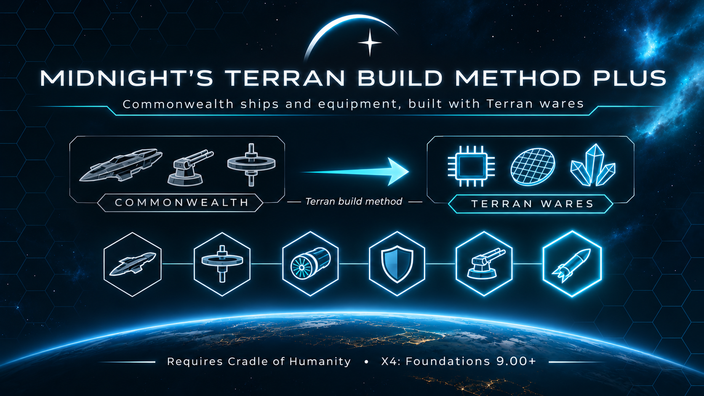
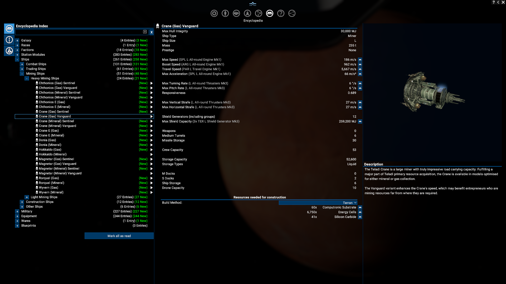
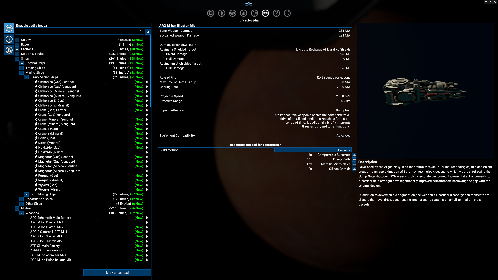
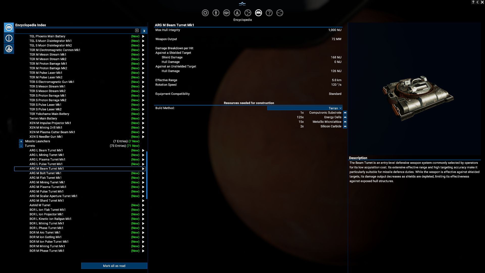
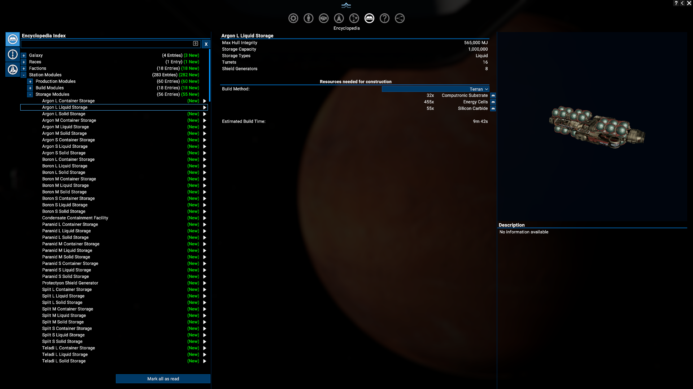

# Midnight's Terran Build Method Plus

Hey! This is my X4: Foundations mod (game version 9.00+). Any station set to the **Terran build
method** can build Commonwealth ships, station modules and equipment from **Terran wares**
instead of hull parts, claytronics and the rest.

I play Terran, and I wanted my Terran stations to build everything the Terran way.

**Get it on the Steam Workshop:** https://steamcommunity.com/sharedfiles/filedetails/?id=3846306118
**Or on Nexus:** https://www.nexusmods.com/x4foundations/mods/2630

**You need the Cradle of Humanity DLC.** The Terran wares and the Terran build method come from it.

## How it works

It isn't a shortcut: the Terran versions cost a bit more in mined resources than the normal
ones, and never less in credits.

| Item | Premium in mined resources |
|---|---|
| Station modules | 1.05x |
| Shields | 1.10x |
| Everything else | 1.2x |

Each Terran recipe is mixed the way Egosoft mixes its own Terran recipes for that kind of item.
Stations on any other build method build exactly like vanilla.

## What it covers

870 Commonwealth ships, station modules, engines, shields, turrets, weapons and missiles,
across the base game and every DLC you own. Items that already have a Terran recipe are left
alone, and the Erlking keeps its normal recipe.

It only affects you. NPC factions build the way they always do: the Commonwealth factions use
their own build methods, and the Terran factions only build their own Terran items. The new
recipes are only used by stations you set to the Terran method (including when NPCs buy ships
at your Terran wharf).

Using [*X4 Upgrade Project (XUP)*](https://www.nexusmods.com/x4foundations/mods/2447?tab=description)?
The optional add-on in `midnights_terran_build_plus_xup/` gives XUP's Commonwealth ships,
weapons and turrets Terran recipes too (also on the Nexus Files tab).

## Tested

I tested this myself in a new game with all the DLCs: a Terran wharf only asks for Terran
wares, and I built ships with it. The encyclopedia shows the Terran recipes:

| Ship | Weapon | Turret | Station module |
|---|---|---|---|
|  |  |  |  |

## Install

Easiest: subscribe on the [Steam Workshop](https://steamcommunity.com/sharedfiles/filedetails/?id=3846306118).

Manual: copy the `midnights_terran_build_plus` folder into `X4 Foundations/extensions/`, so you
end up with `extensions/midnights_terran_build_plus/content.xml`. XUP users copy
`midnights_terran_build_plus_xup` too.

Then set the build method to Terran: Player Information > Global Orders > preferred build
method, or per station. It's safe to add or remove mid-game; just finish or cancel builds that
use its recipes first.

## License

[CC BY 4.0](../LICENSE). Use it, change it, put it in your own mods or modpacks, whatever you
like. Just give me (**Midnight**) credit.

## AI use statement

I did most of the work on this one: the idea, the design, the balance rules and all the
in-game testing. I used an AI assistant (Claude, by Anthropic) as a helper. It checked
everything against the game files and did the number-crunching for the recipes from my rules.
The cover image is AI-generated. The screenshots are from my own game.

## Disclaimer

This is an unofficial fan mod. It isn't affiliated with or endorsed by Egosoft. X4: Foundations
is a trademark of Egosoft GmbH. This repository only contains my own mod files, not any game data.
