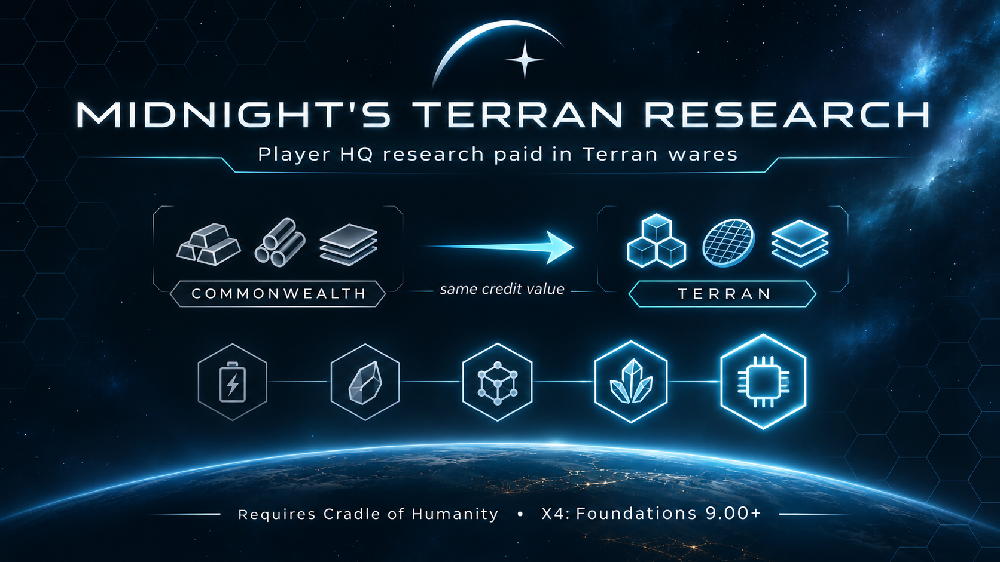
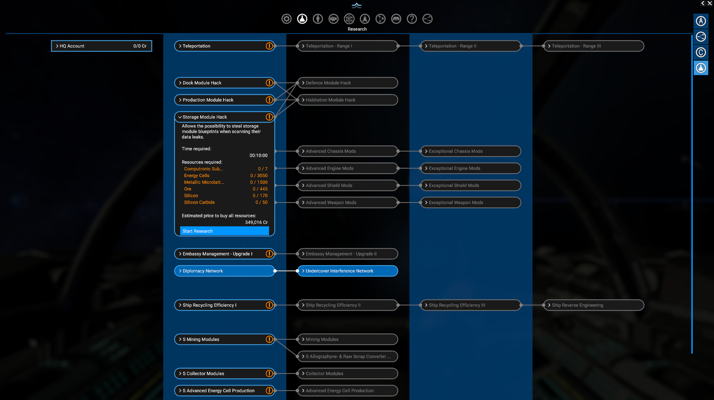
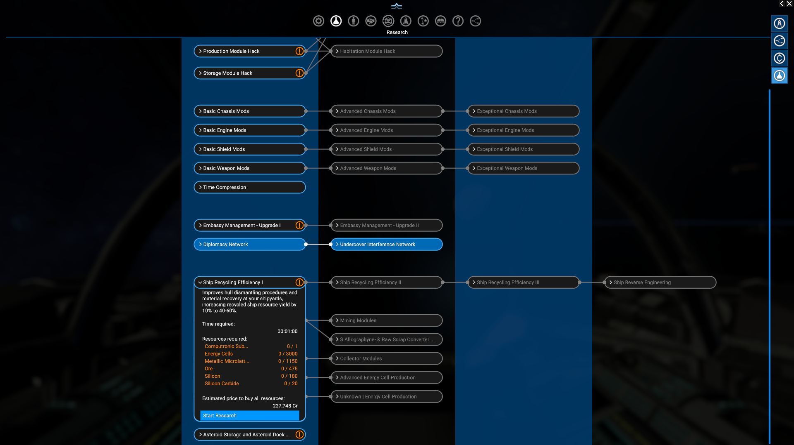

# Midnight's Terran Research

Hey! This is my X4: Foundations mod (game version 9.00+). It makes research at your Player HQ
cost **Terran wares** instead of Commonwealth wares.

I play Terran, and it always bugged me that my HQ research wanted claytronics and hull parts
when my whole economy runs on computronic substrate and microlattice.

I know there are other mods out there that do something like this, but they either don't feel
balanced, or they just remove the Commonwealth costs altogether. I wanted research that still
feels earned, just paid the Terran way. So I made my own.

**Get it on the Steam Workshop:** https://steamcommunity.com/sharedfiles/filedetails/?id=3846161649

**You need the Cradle of Humanity DLC.** Computronic substrate, metallic microlattice and
silicon carbide only exist with it, so the game won't let you enable the mod without it.

## How it works

I didn't want this to be a cheat or a punishment, so every research costs **the same in
credits as it did before** (at average ware prices, within about 1%). You just pay it in Terran
wares instead.

Terran wares are pricey, so the bigger the research, the more of it comes in the expensive
stuff. Cheap research is mostly energy cells, raw resources and microlattice. Big research
leans on silicon carbide and computronic substrate.

| Tier (what it originally cost) | Energy cells | Raw (ore/silicon/nividium) | Microlattice | Silicon carbide | Computronic substrate |
|---|---|---|---|---|---|
| T1: under 200,000 Cr | 25% | 25% | 30% | 15% | 5% |
| T2: 200,000 Cr to 2M | 15% | 15% | 25% | 25% | 20% |
| T3: 2M Cr and up | 10% | 10% | 15% | 25% | 40% |

The raw share is ore and silicon half and half at T1 and T2. At T3 it's 30% ore, 30% silicon
and 40% nividium. If a research already needed nividium, it still does. Amounts are rounded to
nice clean numbers.

## What it covers

34 research items in total:

- Base game: 24
- DLC: Envoy Pack, Tides of Avarice and Timelines (10)

If you don't have one of those DLCs, that part just doesn't apply. No errors.

It only affects you: Player HQ research is something only the player does, so NPC factions are
untouched.

Using [*X4 Upgrade Project (XUP)*](https://www.nexusmods.com/x4foundations/mods/2447?tab=description)?
I made a small optional add-on, *Midnight's Terran Research - XUP Compatibility*, that does the
same for XUP's Ship Recycling Efficiency I, II and III and Ship Reverse Engineering. Grab it
on the [Steam Workshop](https://steamcommunity.com/sharedfiles/filedetails/?id=3846322375),
or copy `midnights_terran_research_xup` from this folder.

## Tested

I tested this myself in a new game with all the DLCs (and XUP with the add-on). I checked the
research costs at my HQ and they matched what they should be:

| Storage Module Hack (base game) | Ship Recycling Efficiency I (XUP add-on) |
|---|---|
|  |  |

Setups with fewer DLCs were checked with validation tools rather than played. If something looks off in your setup, let me know.

## Install

Easiest: subscribe on the [Steam Workshop](https://steamcommunity.com/sharedfiles/filedetails/?id=3846161649).

Manual: copy the `midnights_terran_research` folder into `X4 Foundations/extensions/`, so you end up
with `extensions/midnights_terran_research/content.xml`.

It's safe to add or remove in the middle of a playthrough (it doesn't get baked into your
save). Just don't run it alongside another mod that changes the same research costs, because
only one of them will win.

## License

[CC BY 4.0](../LICENSE). Use it, change it, put it in your own mods or modpacks, whatever you
like. Just give me (**Midnight**) credit.

## Credits

- **Midnight**: that's me. The idea, the design, the balance and the testing.

## AI use statement

I did most of the heavy lifting on this one: the idea, the design, the balance rules and every
decision about how it should work, plus all the in-game testing. I used an AI assistant
(Claude, by Anthropic) as a helper. It checked everything against an X4 modding workspace (the
unpacked game data and validation tools) to make sure every research ID, ware and cost matches
the game. It also did the number-crunching and wrote the patch file from my rules. The cover
image is AI-generated. The screenshots are from my own game. There's no AI-generated voice or
story text in the mod.

## Disclaimer

This is an unofficial fan mod. It isn't affiliated with or endorsed by Egosoft. X4: Foundations
is a trademark of Egosoft GmbH. This repository only contains my own mod files, not any game data.
